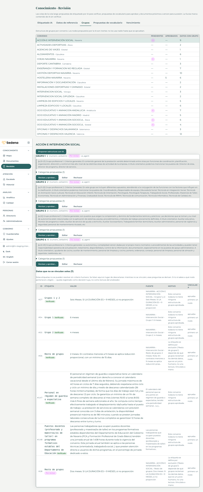
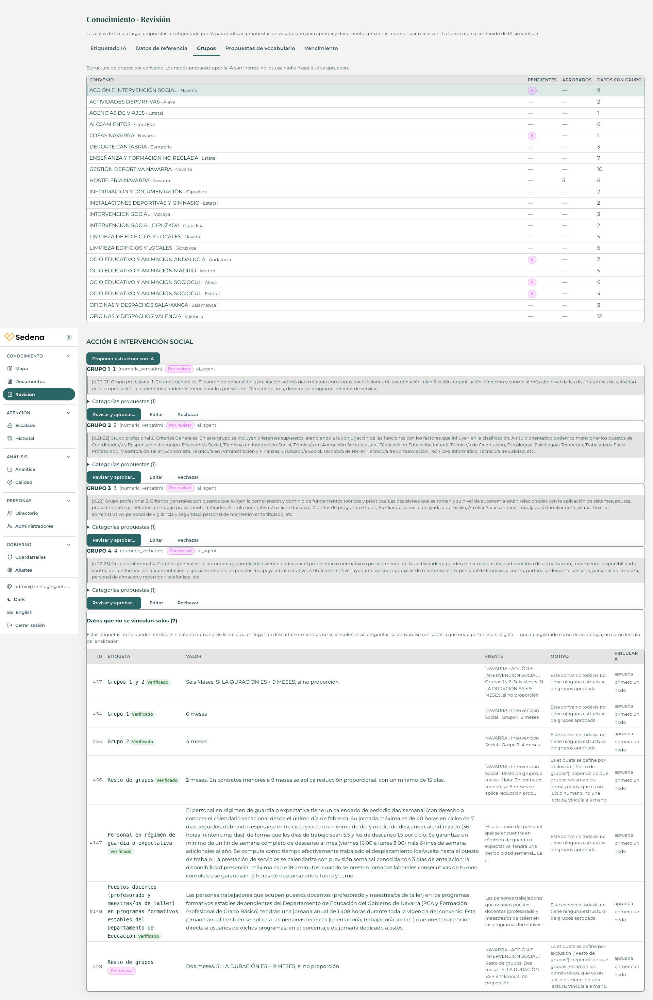
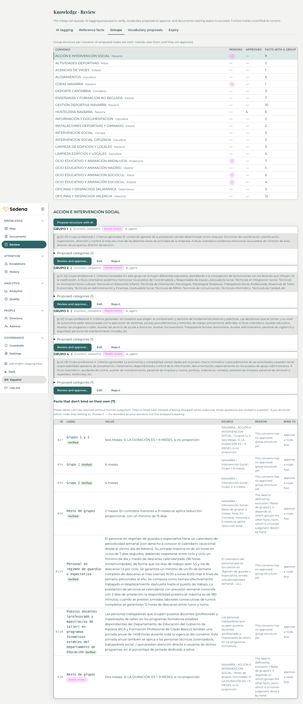
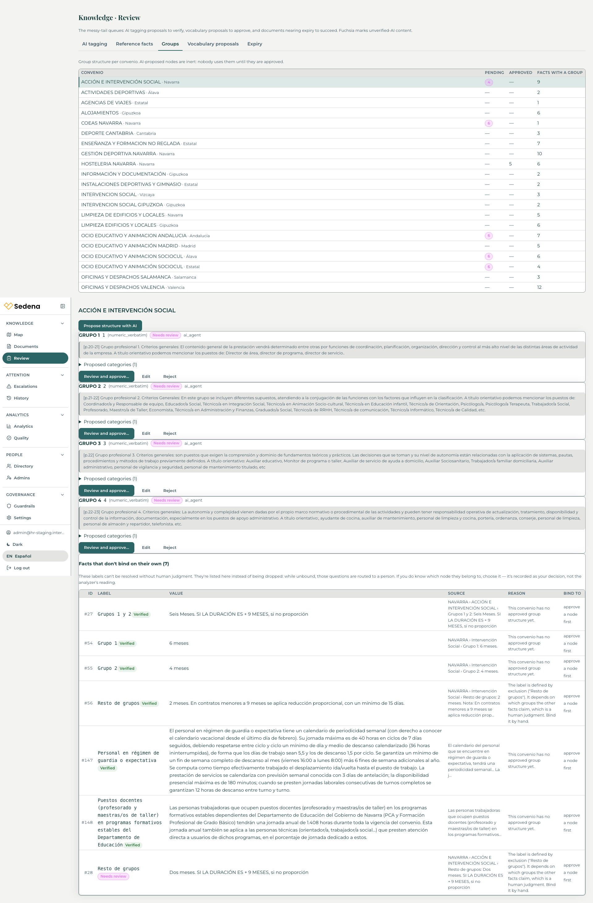

# Slice 12c — review

Eyes-on passed 2026-10-15. This commit closes the slice.

| | |
|---|---|
| What it does | Confirming one eligible document queues a single-document embed. The card shows pending, searchable, or a plain error. Sector aliases COEAS, DEPORTE, and HOSTELERIA no longer raise a sector conflict when the convenio was matched by numero. The review card and the Groups panel display fixes are in the same build. |
| Migrations | `2026_10_14_160000_add_embed_state_to_documents` — nullable `embed_state`, `embed_error_code`, `embed_state_at` on `documents` |
| Backend | `php artisan test --testsuite=Feature` — 1040 passed, 7313 assertions (re-run at close, after the corrections) |
| Frontend | `npx vitest run` — 26 files, 276 tests (re-run at close, after the corrections) |
| Snapshot | `hr-staging-pre-12c-embed`, available before the migrate. It is the backstop for the fixture removal. |
| Fixture | document **107** removed. `tag_events` for it remain. |

## Accepted changes from the plan

Embed status is three columns on `documents`, not a `tag_events` row. `tag_events.facet` stays the document-vocabulary log. The card computes the embed object: live `chunk_count`, null state with chunks greater than 0 reads as searchable, and pending older than 20 minutes reads as `not_finished` without a write.

`EmbedDocument` does not set `$tries`. It uses `WithoutOverlapping('embed-documents')->releaseAfter(60)->expireAfter(1200)`, `$maxExceptions = 1`, `retryUntil()` two hours out, and `$uniqueFor = 1800`. A held overlap lock releases the job and writes no failed state. A real exception fails once.

A confirm on a document that is already verified only queues the embed. It does not write another "tags confirmed" row and does not touch review tasks.

Option B is built. `DocumentTagger::SECTOR_CONFLICT_ALIASES` is COEAS, DEPORTE, HOSTELERIA. Rule 3 is skipped for those when the convenio was matched by numero. Any other disagreeing sector still conflicts. Documents 29, 40, 73, and 87 were not re-ingested.

`groupsQueue.diffNote` is translated in `en.ts` and `es.ts`. The Groups reason texts go through the same dictionaries. The API still returns the planner's Spanish `reason` and `diff.note`; the screen does not render them.

`retry_after` stays 90 seconds and there is still one queue worker. `deploy.md` says a second worker needs a separate queue connection whose `retry_after` is above the 1200s job timeout, and that the worker and the scheduler must use the same `APP_NAME` and `CACHE_STORE` as the web process.

Historical documents are not embedded on confirm. An `official_convenio` with a null convenio is not embedded. A `national_law` with a null convenio still queues. A lifecycle edit queues the same job only when the document crosses into eligible. Nothing is embedded at deploy.

## Staging proof

Snapshot `hr-staging-pre-12c-embed` was available before `php artisan migrate --force`. The only migration that ran was `2026_10_14_160000_add_embed_state_to_documents`. The box compose file was not replaced, so `STAGING_FIXED_OTP_CODE` stayed `135790`. The instance was not resized. `chunks:embed` was not run. One worker remained.

The required filename has no convenio numero, so ingest left the document `under_review` with `convenio_id` null. D1 would not embed that. Before confirm, the existing facet endpoint bound convenio **22** (`31004605011982`, LIMPIEZA DE EDIFICIOS Y LOCALES) with `confirm_scope_change=true`. That convenio is the one on `test-navarra@example.com`.

| | |
|---|---|
| id | 107 |
| uuid | `8fdc44ed-92f5-483f-b190-f86b3fdedcf5` |
| title | TEST-12c-embed-proof |
| file | TEST-12c-embed-proof.pdf, one page |
| type | `convenio_text`, `official_convenio`, `active` at confirm |
| page text | the sentence that names the day ZQX12C |

Before confirm, asking that sentence as `test-navarra@example.com` (message 8645) retrieved document 36 at the top. Document 107 was not in the trace. Confirm was a click on **Confirmar etiquetas** in the review queue. The card showed **Indexando…**, then **Buscable · 1 fragmentos**. The button became **Etiquetas confirmadas ✓** and stayed disabled. The worker log is `EmbedDocument` DONE in 791.93ms at 16:44:22 UTC. Provenance gained one `tags confirmed` row and no embed row. The open unresolved task went to `resolved`.

After that, the same question (message 8647) retrieved chunk 4316 of document 107 at score 1.0, convenio 22, `retrieval_status` active, with a vector. The employee-facing answer did not cite it. `/synthesise` and `/route` returned `provider_error`. A direct synthesise call returned `401 invalid x-api-key`. A shorter retry (message 8649) escalated the same way. `message_citations` has no row for 107. The staging answer key is rejected by the provider. That is outside this slice; the key was not changed.

The second confirm returned in 0.08s with `embed_queued: true` and did not write another "tags confirmed" row. The job was not inserted. `cache_locks` still held `hr-platform-cache-laravel_unique_job:App\Jobs\EmbedDocument:107` until 17:14:21 UTC, which is `uniqueFor` after the first dispatch. The web process acquires that lock under `APP_NAME=HR Platform`. The worker had no `APP_NAME`, so its cache prefix was `laravel-cache-` and `forceRelease` did not delete the row. The document sat `pending` with the existing 1 chunk.

The worker service now sets `APP_NAME: "HR Platform"` and `CACHE_STORE: database`, in the repo compose and by an in-place edit of the box file. Only the worker was recreated. OTP was checked afterwards and was still `135790`. The orphan lock for document 107 was deleted, confirm was posted again, and the worker finished `EmbedDocument` in 838.53ms. Result: `searchable`, `chunk_count` 1, still one "tags confirmed" row, the review task still `resolved`, and no EmbedDocument row left in `cache_locks`.

Lifecycle was then set to `historical` with `confirm_scope_change`. The response was `embed_queued: false`. The document is historical, verified, with one chunk. The active + verified + prose + 0-chunk query was empty before the proof and empty after it. The only `document_chunks` rows created in the last three hours are the one row for document 107.

Remove document 107 before production.

## Corrections after the review

`tsc -b` passed inside the staging frontend image build. `groupsQueueDisplay.test.ts` and `searchableLine.test.ts` passed locally (4 tests). The table counts are the full re-run at close, after these corrections.

### Answer key

The message named the place to put a new key and did not include the key itself, so nothing was written into the repo or into SSM. `deploy.sh` and `vars.sh` have no answer-key parameter. Staging reads the encrypted `answer_model_settings` row. That row was already updated at **2026-10-15 00:01:27 UTC**, masked last four `ZwAA`. `hr-backend` and the worker were not recreated; the key is read from the database per call. The scheduler was recreated for the cache-prefix fix below. `STAGING_FIXED_OTP_CODE` is still `135790`. A verify-code call with that OTP returned 200 and a token.

A `/synthesise` call with one valid chunk returned an answer. The client only returns that body when hr-ai responds HTTP 200. There was no `provider_error` and no 401.

`message_traces` stores `synthesis.error = provider_error` and does not store the 401 text. The earliest such row is message **2739** at **2026-09-29 11:59:56 UTC**. Chat recovered: 113 syntheses with a citation count and no error ran from 2026-09-29 12:00:48 through 2026-10-05 00:26:33 (message 8609). The next `provider_error`, and the first of the outage that was still open at the previous review, is message **8645** at **2026-10-14 16:42:03 UTC**.

Asked as `test-coeas-estatal@example.com`: “¿Cuántos días de vacaciones tengo?”. Message **8651** came back `outcome: answer`, not escalated. It cites document **76**, title `99100055012011 COEAS Estatal 2025 2027`: chunk 4237, page 29, and a second citation on the same document with no chunk (a reference fact).

### Fixture 107

There is no document-delete route. `AnswerModelController::destroy` only clears the answer key. Removal was a scoped delete of document 107, title `TEST-12c-embed-proof`, uuid `8fdc44ed-92f5-483f-b190-f86b3fdedcf5`. Its one chunk (id 4317) was deleted first. The document row was deleted second. The foreign keys cascade the page and the review task, so those one-row children went with it. Nothing else pointed at the document, and it had no citations. `tag_events` has no foreign key to `documents`; the 7 rows for entity 107 are still there. Snapshot `hr-staging-pre-12c-embed` was not replaced.

Afterwards the documents list (all 3 pages) and the knowledge-graph payload do not contain `TEST-12c-embed-proof`. The Map and Documents screens do not show it either.

### Plural

Searchable copy is now singular at one chunk: Spanish `Buscable · 1 fragmento` / `Buscable · {count} fragmentos`, English `Searchable · 1 chunk` / `Searchable · {count} chunks`. `searchableLine.test.ts` covers the singular and the plural.

### Scheduler

The scheduler already had `CACHE_STORE: database` and did not set `APP_NAME`, so its cache prefix was `laravel-cache-` while web and worker use `hr-platform-cache-`. The repo compose and the box compose now set `APP_NAME: "HR Platform"` on `hr-backend-scheduler`. The box file was edited in place. OTP stayed `135790`. The scheduler container was recreated with `vars.sh` exports. `printenv` on web, worker, and scheduler is `APP_NAME=HR Platform` and `CACHE_STORE=database`.

### Groups layout

The convenio list and its detail stack, full width, on the page background. The detail scrolls with the page. Choosing a row scrolls to the detail once that convenio’s tree has loaded, and the row keeps the `selected` highlight. `groupsQueueDisplay.test.ts` now requires the column stack, the nowrap count columns, no inner max-height, and the scroll call.

Checked in Chrome at 1440 and 1920, Spanish and English, with **ACCIÓN E INTERVENCIÓN SOCIAL · Navarra** selected. All four headers are on one line (`Datos con grupo` / `Facts with a group`). The name is one line. The detail’s six-column facts table is the full content width (1160px at 1440, 1640px at 1920). Selecting the row moved the page to the detail (`scrollY` 981 at Spanish 1440, detail top 0).

## Display, checked on staging

The served stylesheet has `.notice--ai { display: block }` and a margin on `.ai-pill`. The fixture card has no AI banner, because the document is filename-unresolved rather than an AI proposal.

On Groups, the check below replaces the two-column grid described in the first pass. Hostelería Navarra still renders **Grupo 1** and the matcher key **1** as separate items. Fact #35 renders the English exclusion sentence, not the planner's Spanish reason. The English diff note is in the shipped English chunk; the Spanish sentence is in the main bundle. The approve dialog itself was not opened.

## Files

Backend: `EmbedDocument`, `DocumentEmbedder`, `EmbedQueue`, `EmbedEligibility`, the migration, `Document`, `DocumentController` (confirm, show, lifecycle), `ChunksEmbed` (calls the shared embedder), `DocumentTagger`, `Slice12cEmbedOnConfirmTest`, `Slice12cSectorAliasTest`.

Frontend: `DocumentDetailPanel` (`searchableLine`), `GroupsQueue`, `index.css`, `api.ts`, `en.ts`, `es.ts`, `groupReasons.test.ts`, `groupsQueueDisplay.test.ts`, `searchableLine.test.ts`, and the chunk-health fixture's `embed` field.

Docs: `deploy.md`, `infra/compose/docker-compose.staging.yml` (worker and scheduler `APP_NAME`, both `CACHE_STORE: database`), this file, and `plan.md`. The four Groups screenshots sit next to this file. `review-triage/under-review-2026-10-14.md` and `.json` are the redacted queue export (`[nombre]` / `[DNI]`). `client-asks.md` and `roadmap.md` carry the triage asks and the §7 tickets.

`count-strings.mjs` and `count-strings-output.json` stay untracked. The operator note `review-triage-2026-10-14.md` was not in the workspace at close.
